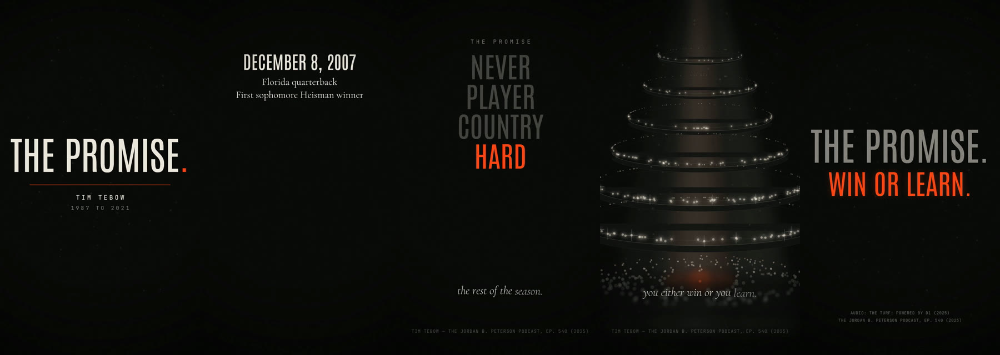
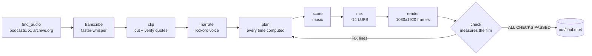

<p align="center"></p>

<p align="center">
  <a href="LICENSE"></a>
  
  
  
</p>

# Plutarch

Plutarch is an agent skill that makes a short vertical documentary about a real person for X. The person is
heard in **real recordings of their own voice**; a narrator gives the facts; music, word-by-word captions and
original motion graphics come from the skill's own scripts. An agent drives it one printed command at a time,
and a local open-weight model can run it; how far small models get today is under [Status](#status). Free and
local by default: no GPU, no API key.

<p align="center"></p>
<p align="center"><sub>Frames from the test film, built from two podcast interviews: The Turf and The Jordan B. Peterson Podcast (2025).</sub></p>

`scripts/next.py` reads the project and prints the one next step with its exact command. Every other step is
a script that prints `OK`, `ERROR` or `FIX: <exactly what to do>`, and `film.py` makes every change to the
film's JSON, so the agent never has to guess timestamps, mix audio, draw frames or write JSON by hand. `check.py` measures the finished film (sync, loudness, captions,
sources, quote verification) and decides when it is done.

## How it works

Sound comes first. Every picture event is timed from the finished mix, so captions and impacts land on the word.



The agent does what makes a film good: the research, the sources, which quotes to use, the narrator's lines
and the order of the beats. The scripts do what a small model fumbles: timing, alignment, mixing, mastering
and drawing.

## What is in here

```
plutarch/              the skill: install this folder
  SKILL.md             a short loop: run next.py, do what it prints, repeat until DONE
  references/          steps · decisions · craft · finding audio · voices, music and SFX · film.json fields
  scripts/             next (what to do now) · film (edit film.json) · setup · find_audio · transcribe · clip · narrate · plan · score · mix · render · check
  templates/           film.json (placeholders only) · story.md
  fonts/               Antonio, Cormorant Garamond, JetBrains Mono (SIL Open Font License)
distill/               for testing the skill on a student model with skill-distill (sybil-solutions)
assets/                logo
```

## Install

Copy `plutarch/` to where your agent looks for skills:

| harness | folder |
|---|---|
| omp (Oh My Pi) | `~/.omp/agent/skills/plutarch/` |
| pi | `~/.pi/agent/skills/plutarch/` |
| Claude Code | `~/.claude/skills/plutarch/` |
| Codex | `~/.agents/skills/plutarch/` |

Then once per machine:

```
python3 -m venv ~/.venvs/plutarch && . ~/.venvs/plutarch/bin/activate
python3 ~/.omp/agent/skills/plutarch/scripts/setup.py --install     # ends with: SETUP OK.
```

Needs Python 3.10+ and ffmpeg. `demucs` and `torchaudio` are optional but recommended: they give exact word
timing on recordings with music or crowd noise. Models download on first use (about 1.5 GB).

## Use

Ask your agent for a documentary about someone. Or by hand:

```
python3 <skill>/scripts/setup.py --init ~/films/name && cd ~/films/name
python3 scripts/next.py      # prints the next step; repeat until it prints DONE
# or run the back half yourself once the quotes and scenes are in:
python3 scripts/clip.py make && python3 scripts/narrate.py && python3 scripts/plan.py
python3 scripts/score.py synth && python3 scripts/mix.py
python3 scripts/render.py --sheet && python3 scripts/render.py && python3 scripts/check.py
```

## Swap any engine

| part | default (local, free) | also works |
|---|---|---|
| narrator | Kokoro | Piper · any OpenAI-style TTS server (Kokoro-FastAPI, LocalAI, vLLM-Omni) · OpenAI · ElevenLabs · any command (Chatterbox, Qwen3-TTS, VoxCPM ...) |
| music | built-in score | local ACE-Step 1.5 server · any generator via a timed prompt (`score.py prompt` + `pick`) |
| sound effects | made in code | drop in `sfx/impact.wav`, `sfx/riser.wav` |
| search | your agent's own tools | SearXNG (`SEARXNG_URL`) · Brave (`BRAVE_API_KEY`) · keyless `ddgs` |
| audio sources | podcasts (iTunes API + RSS), posts on X, archive.org | YouTube via yt-dlp (often bot-blocked on servers) |

## Rules built in

- Every quote is cut from a real recording and verified word by word against it. No quote from memory.
- The subject's voice is never synthesized or cloned. The narrator is a stock voice.
- No photos or footage of the person: original motion graphics only.
- Every audio source is credited on screen.

## Status

Measured on 2026-11-24 with local models under the pi harness on one machine, transcription on the CPU.

- **The scripts finish a film.** On the test film, a driver that runs only the first command `next.py` prints
  went from cutting quotes to `DONE`, and `check.py` passed on the 134.6 s render.
- **Small models do not load the skill on their own.** Asked for a documentary 6 times each without naming the
  skill, qwen2.5:1.5b, qwen3:4b and LFM2.5-8B-A1B read SKILL.md 0 of 6 times. LFM2.5-24B-A2B read it 6 of 6,
  and ran a kit script 6 of 6 after the description was rewritten (2 of 6 before). Name the skill
  (`/skill:plutarch` in pi) when you use a small model.
- **No local model has finished a film yet.** In 35-minute runs with the skill named, qwen3:4b on the first
  version downloaded and transcribed a real interview but wrote its own film.json outside a project (step 1 of
  12). Those failures led to `next.py`, `film.py` and the `cd` prefix on every printed command. Runs of the
  current version on qwen3:4b, LFM2.5-8B-A1B and LFM2.5-24B-A2B are in progress.

`distill/DISTILL.md` has the acceptance checks for testing a student model with
[skill-distill](https://github.com/sybil-solutions/skill-distill).

## License

The code and docs are [MIT](LICENSE). The fonts in `plutarch/fonts/` (Antonio, Cormorant Garamond,
JetBrains Mono) keep their own SIL Open Font License; the license text sits next to each font.
