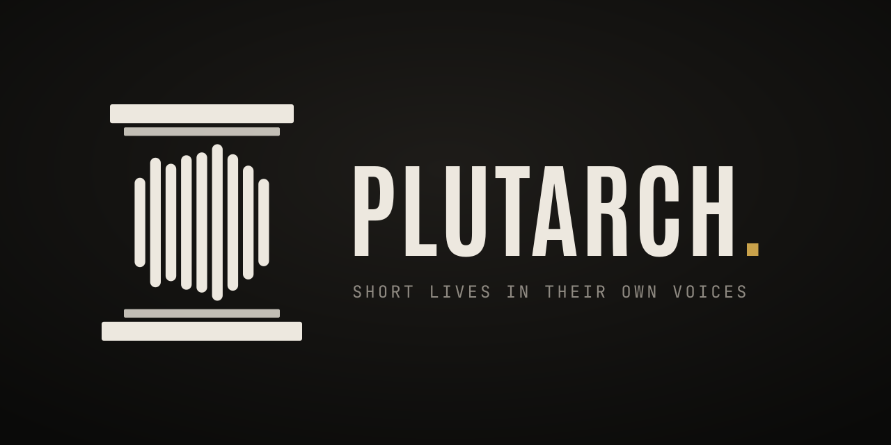

<p align="center"></p>

# Plutarch

A skill that lets a local AI agent, even a small open-weight one, make a short vertical documentary about a
real person for X: **real recordings of their own voice**, a narrator for the facts, music, word-by-word
captions and original motion graphics. Free and local by default: no GPU, no API key.

Every step is a script that prints `OK`, `ERROR` or `FIX: <exactly what to do>`, so the agent never has to
guess timestamps, mix audio or draw frames. `check.py` measures the finished film (sync, loudness, captions,
sources, quote verification) and decides when it is done.

## What is in here

```
plutarch/              the skill: install this folder
  SKILL.md             the steps, written for literal-minded models
  references/          craft · finding audio · voices, music and SFX · film.json fields
  scripts/             setup · find_audio · transcribe · clip · narrate · plan · score · mix · render · check
  templates/           film.json (placeholders only) · story.md
  fonts/               Antonio, Cormorant Garamond, JetBrains Mono (SIL Open Font License)
distill/               for testing the skill on a student model with skill-distill (sybil-solutions)
assets/                logo
```

## Install

Copy `plutarch/` to where your agent looks for skills:

| harness | folder |
|---|---|
| omp (Oh My Pi) | `~/.omp/agent/skills/plutarch/` |
| pi | `~/.pi/agent/skills/plutarch/` |
| Claude Code | `~/.claude/skills/plutarch/` |
| Codex | `~/.agents/skills/plutarch/` |

Then once per machine:

```
python3 -m venv ~/.venvs/plutarch && . ~/.venvs/plutarch/bin/activate
python3 ~/.omp/agent/skills/plutarch/scripts/setup.py --install     # ends with: SETUP OK.
```

Needs Python 3.10+ and ffmpeg. `demucs` and `torchaudio` are optional but recommended: they give exact word
timing on recordings with music or crowd noise. Models download on first use (about 1.5 GB).

## Use

Ask your agent for a documentary about someone. Or by hand:

```
python3 <skill>/scripts/setup.py --init ~/films/name && cd ~/films/name
# find audio, fill story.md and film.json (SKILL.md steps 1-5), then:
python3 scripts/clip.py make && python3 scripts/narrate.py && python3 scripts/plan.py
python3 scripts/score.py synth && python3 scripts/mix.py
python3 scripts/render.py --sheet && python3 scripts/render.py && python3 scripts/check.py
```

## Swap any engine

| part | default (local, free) | also works |
|---|---|---|
| narrator | Kokoro | Piper · any OpenAI-style TTS server (Kokoro-FastAPI, LocalAI, vLLM-Omni) · OpenAI · ElevenLabs · any command (Chatterbox, Qwen3-TTS, VoxCPM ...) |
| music | built-in score | local ACE-Step 1.5 server · any generator via a timed prompt (`score.py prompt` + `pick`) |
| sound effects | made in code | drop in `sfx/impact.wav`, `sfx/riser.wav` |
| search | your agent's own tools | SearXNG (`SEARXNG_URL`) · Brave (`BRAVE_API_KEY`) · keyless `ddgs` |
| audio sources | podcasts (iTunes API + RSS), posts on X, archive.org | YouTube via yt-dlp (often bot-blocked on servers) |

## Rules built in

- Every quote is cut from a real recording and verified word by word against it. No quote from memory.
- The subject's voice is never synthesized or cloned. The narrator is a stock voice.
- No photos or footage of the person: original motion graphics only.
- Every audio source is credited on screen.

## Status

The teacher side of [skill-distill](https://github.com/sybil-solutions/skill-distill) is done: the acceptance
checks pass on the reference film and fail on known-bad cuts, and the scripts run end to end on four test
films with the default local engines. **It has not been run with a student model yet.** See
`distill/DISTILL.md` for the commands and what to watch.
